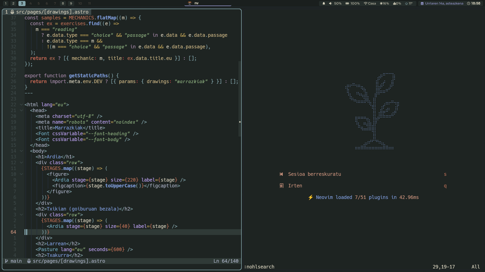
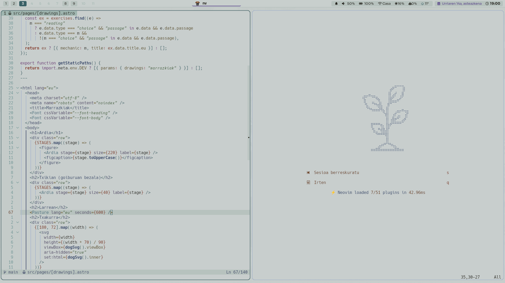

<div align="center">

# Eibar

A dark and light colorscheme for Neovim.

**Dark**



**Light**



</div>

## Requirements

- Neovim 0.8+
- `termguicolors` (set automatically by the colorscheme)

## Installation

With [lazy.nvim](https://github.com/folke/lazy.nvim):

```lua
{
    "dPenedo/eibar.nvim",
    lazy = false,
    priority = 1000,
    config = function()
        require("eibar").setup({})
        vim.cmd.colorscheme("eibar")
    end,
},
```

## Usage

Three colorschemes are available:

- `eibar`: follows `vim.o.background`.
- `eibar-dark`: sets `background=dark` and loads the dark palette.
- `eibar-light`: sets `background=light` and loads the light palette.

```lua
vim.cmd.colorscheme("eibar")
```

## Configuration

Call `setup()` before loading the colorscheme. These are the defaults:

```lua
require("eibar").setup({
    transparent = false, -- transparent background for Normal and lualine
    background_style = "normal", -- see "Background styles" below
    italics = {
        comments = true,
        keywords = true,
        functions = false,
        parameter = true, -- parameters and LSP inlay hints
        strings = true,
        variables = false,
    },
    overrides = {}, -- table of highlight groups, or a function returning one
})
```

`overrides` is applied last, on top of every built-in group:

```lua
require("eibar").setup({
    overrides = {
        Comment = { fg = "#7a8a87", italic = false },
        CursorLine = { link = "Visual" },
    },
})
```

### Background styles

`background_style` only changes the background shades (`base00` to `base05`); the syntax colors stay the same. The available styles are still experimental and may change: see the `backgrounds` table in [`palettes/dark.lua`](./lua/eibar/palettes/dark.lua) and [`palettes/light.lua`](./lua/eibar/palettes/light.lua). An unknown name falls back to the default of each palette.

To try them live, use `:EibarBackground <style>` (it completes the names).

## Integrations

Highlights are included for:

- Treesitter and LSP (semantic tokens, inlay hints, diagnostics)
- [render-markdown.nvim](https://github.com/MeanderingProgrammer/render-markdown.nvim)
- [nvim-cmp](https://github.com/hrsh7th/nvim-cmp)
- [snacks.nvim](https://github.com/folke/snacks.nvim)
- [indent-blankline.nvim](https://github.com/lukas-reineke/indent-blankline.nvim)
- [barbar.nvim](https://github.com/romgrk/barbar.nvim)
- [flash.nvim](https://github.com/folke/flash.nvim)
- [mini.files](https://github.com/echasnovski/mini.files)
- [neo-tree.nvim](https://github.com/nvim-neo-tree/neo-tree.nvim)
- [gitsigns.nvim](https://github.com/lewis6991/gitsigns.nvim)
- [agentic.nvim](https://github.com/carlos-algms/agentic.nvim)
- Terminal colors (`terminal_color_0` to `terminal_color_15`)

### Lualine

```lua
require("lualine").setup({
    options = { theme = "eibar" },
})
```

## Contributing

Issues and pull requests are welcome.
